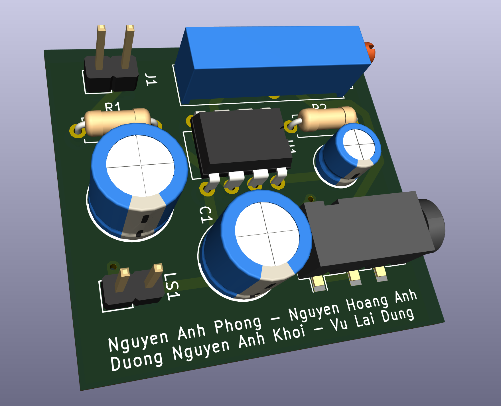
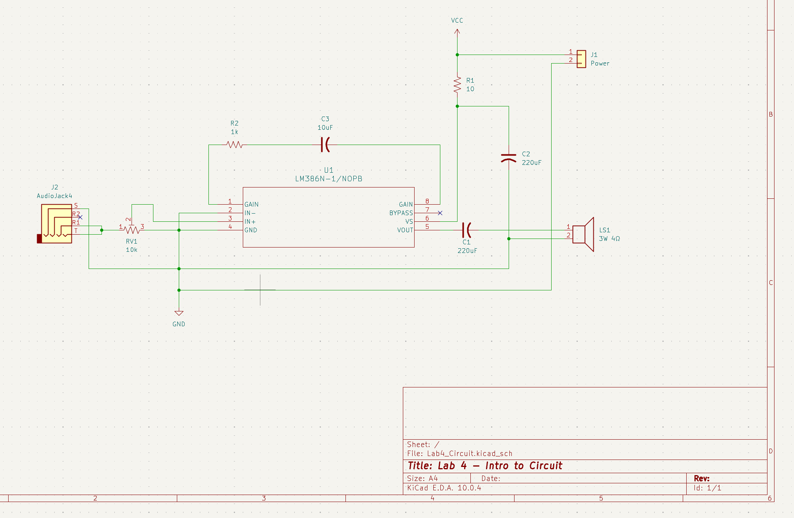
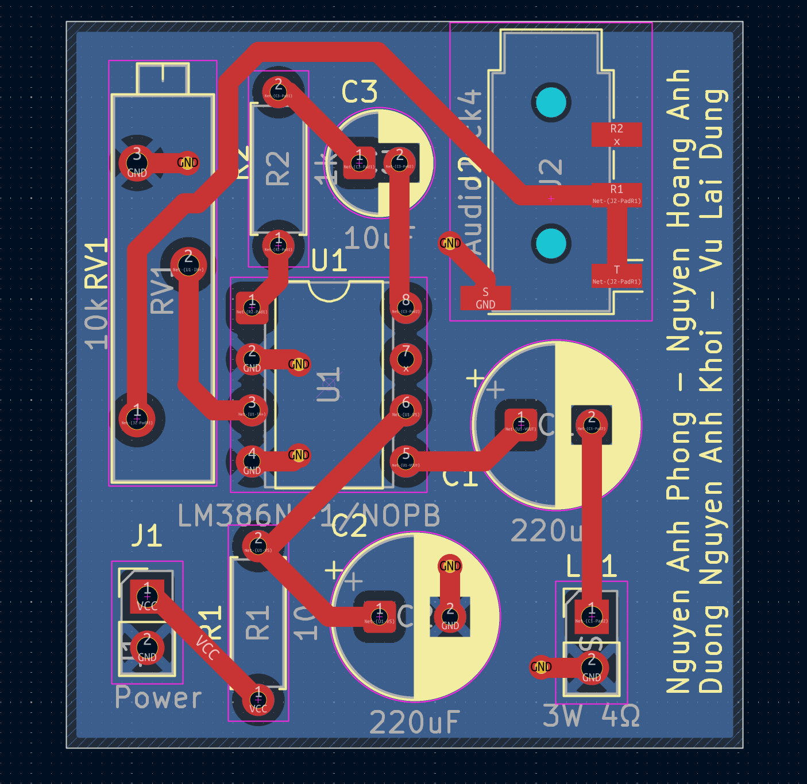

# LM386 Audio Amplifier PCB (KiCad)

A small mono audio amplifier built around the LM386, designed in KiCad 10 for **Lab 4 – Intro to Circuit** at VinUniversity. Plug a phone or laptop into the 3.5 mm jack, set the volume with the 10k pot, and it drives a 4 Ω / 3 W speaker.

<p align="center">
  
</p>

## Previews

### Schematic


### PCB layout
<p align="center">
  
</p>


## How it works

- **Input:** the 3.5 mm TRRS jack (J2) has its Tip and Ring 1 tied together, so left and right are summed into one mono signal. Sleeve goes to ground.
- **Volume:** RV1 (10k) works as a voltage divider. Its wiper feeds the LM386 non-inverting input (pin 3); the inverting input (pin 2) is grounded.
- **Gain:** R2 (1k) in series with C3 (10 µF) across the GAIN pins (1 and 8) raises the gain from the default 20 to roughly 50. Remove them for gain 20, or short R2 for gain 200.
- **Output:** C1 (220 µF) blocks the DC offset at VOUT (pin 5) before it reaches the speaker (LS1).
- **Supply:** power comes in on J1. R1 (10 Ω) and C2 (220 µF) form an RC filter on the VS pin (pin 6) to keep supply noise out of the amp. The BYPASS pin (7) is left unconnected.

## Bill of materials

| Ref | Value | Part / footprint |
|-----|-------|------------------|
| U1 | LM386N-1/NOPB | DIP-8 |
| RV1 | 10 kΩ | Trimmer potentiometer |
| R1 | 10 Ω | Axial resistor |
| R2 | 1 kΩ | Axial resistor |
| C1 | 220 µF | Electrolytic, output coupling |
| C2 | 220 µF | Electrolytic, supply decoupling |
| C3 | 10 µF | Electrolytic, gain setting |
| J1 | — | 2-pin header, power (VCC / GND) |
| J2 | AudioJack4 | PJ-320D 3.5 mm jack |
| LS1 | 3 W, 4 Ω | Speaker, 2-pin header |

## Repository contents

| File | Description |
|------|-------------|
| `Lab4_Circuit.kicad_pro` | KiCad project |
| `Lab4_Circuit.kicad_sch` | Schematic |
| `Lab4_Circuit.kicad_pcb` | PCB layout |
| `lm386.kicad_sym` | Custom LM386 symbol |
| `PJ-320D-A--3DModel-STEP-56544.STEP` | 3D model for the audio jack |
| `images/` | Preview images used in this README |

## Opening the project

1. Install [KiCad](https://www.kicad.org/) 10.0 or newer.
2. Clone the repo:
   ```bash
   git clone https://github.com/phongna07/audio-amplifier-pcb-kicad.git
   ```
3. Open `Lab4_Circuit.kicad_pro`.

If the jack shows up without a 3D model, point its footprint's 3D model path at the `.STEP` file in this repo.

## Team

- Nguyen Anh Phong
- Nguyen Hoang Anh
- Duong Nguyen Anh Khoi
- Vu Lai Dung
